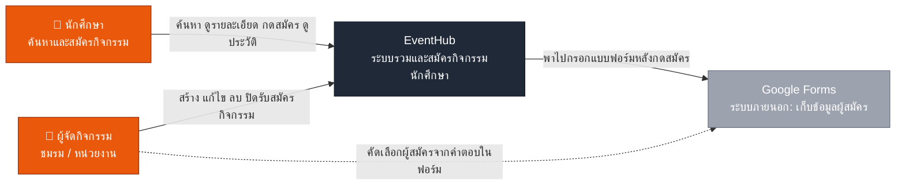
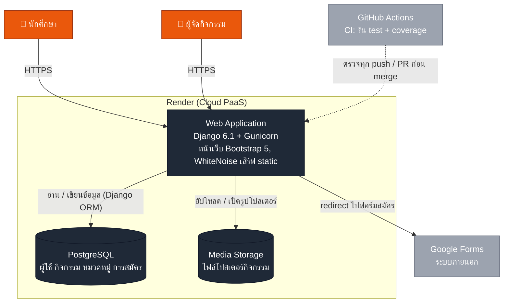
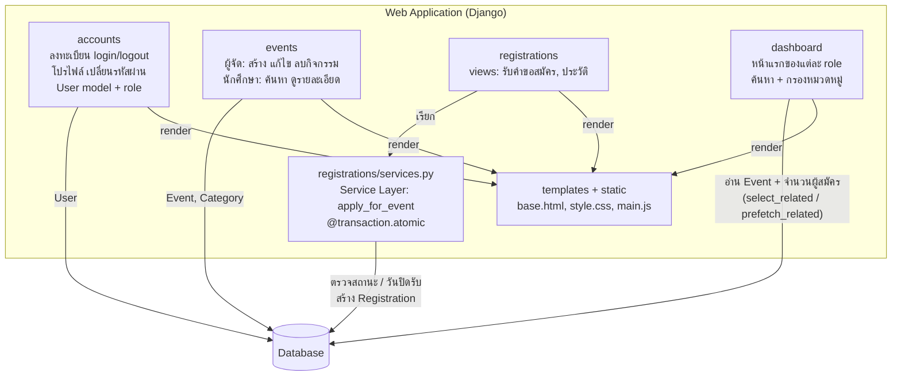

# EventHub Architecture (C4 Model)

EventHub เป็น Modular Monolith: เว็บ Django ตัวเดียว แบ่งงานเป็น Django app ตามหน้าที่
และแยก business logic ของการสมัครกิจกรรมไว้ใน Service Layer (`registrations/services.py`)

## Level 1: System Context

ใครใช้ระบบ และระบบคุยกับระบบภายนอกอะไรบ้าง

## Level 2: Container

ข้างในระบบ EventHub ที่ deploy บน Render ประกอบด้วยอะไรบ้าง

ในเครื่องนักพัฒนาใช้ SQLite แทน PostgreSQL (เลือกจาก `DATABASE_URL` ใน `event_hub/settings.py`)

## Level 3: Component (ภายใน Web Application)

แต่ละ Django app ทำอะไร และเรียกกันอย่างไร

## การตัดสินใจหลักและเหตุผล

| เรื่อง | เลือก | เหตุผล |
|---|---|---|
| รูปแบบระบบ | Modular Monolith | ทีม 6 คน แบ่งงานตาม Django app ได้ชัด deploy ตัวเดียว ไม่ซับซ้อน |
| การสมัคร | Service Layer + `@transaction.atomic` + `select_for_update` | กันสมัครซ้ำเมื่อกดพร้อมกัน และแยก logic ให้ทดสอบได้โดยไม่ผ่านหน้าเว็บ |
| จำนวนผู้สมัคร | ไม่จำกัด | ผู้จัดคัดเลือกจริงผ่าน Google Forms ส่วน `max_participants` คือจำนวนที่ผู้จัดจะรับ |
| ป้องกัน N+1 Query | `select_related` / `prefetch_related` / `annotate` | หน้า dashboard และประวัติการสมัครดึงข้อมูลที่เกี่ยวข้องใน query เดียว |
| ค่าลับ | Environment Variables บน Render | `SECRET_KEY`, `DEBUG`, `DATABASE_URL` ไม่อยู่ในโค้ด |
| เวลา | `TIME_ZONE = Asia/Bangkok`, `USE_TZ = True` | เก็บเป็น UTC ในฐานข้อมูล แสดงผลเป็นเวลาไทย |